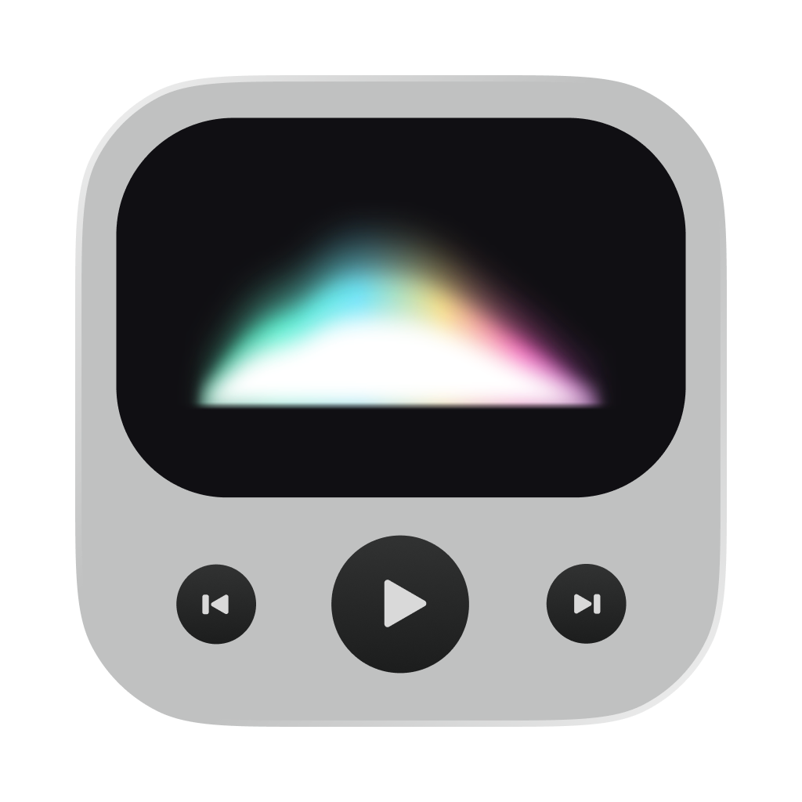

<p align="center">
  
</p>
<h1 align="center">Spectrum</h1>
<p align="center">A native macOS music visualizer and companion player for Spotify.<br>Developed by PIKO.</p>

Spectrum brings audio-reactive visuals, playback controls, and optional lyrics to a desktop player and a compact menu bar companion. Built with SwiftUI, AppKit, Core Audio Process Taps, and Accelerate.

## Features

- **Three visualizers:** Aurora glow, green segmented frequency bars, and stereo analog-style VU meters.
- **Spotify controls:** play/pause, previous/next track, seek, shuffle, repeat, and artwork when available.
- **Volume control:** choose Spotify volume or the current macOS output device, including live knob adjustments.
- **Optional lyrics:** synced or plain lyrics from LRCLIB, with a Lyrics / EQ switch.
- **Menu bar player:** pin to keep visible, change visualizers, and control playback without replacing the foreground app's menu bar.
- **Native window behavior:** launch opens the main player; Close keeps the app running; Minimize uses macOS's window preview; Quit exits.
- **Power-aware capture:** audio capture and FFT pause when no visualizer is visible, including Lyrics mode, minimized/covered windows, and display sleep. Explicit Stop remains off.
- **Demo mode:** synthetic audio for trying visuals without Spotify capture.

## Requirements

- macOS **14.2 or newer**.
- Spotify's desktop app for Spotify controls and process capture.
- Xcode **16 or newer** for development. The current project was validated with Xcode 26.2.
- Internet access for artwork and optional LRCLIB lyrics.

## Build and run

1. Clone or download this repository.
2. Open **`Spectrum.xcodeproj`** in Xcode.
3. Select the **Spectrum** scheme and **My Mac**, then Run.
4. Open Spotify and play a track.
5. Allow **Automation → Spotify** for playback controls, and **System Audio Recording** for visualization when macOS requests them.

In Spectrum Settings, enable the visualizer and select all Spotify processes or an available individual process. If capture is unavailable, the status explains the failure; enable **Demo signal (not Spotify)** to try synthetic visuals. Demo is labeled and is never presented as live Spotify audio.

Terminal build and checks:

```sh
bash Scripts/build.sh
bash Tests/run.sh
```

The build script writes an **unsigned universal app** to `build/DerivedData/Build/Products/Release/Spectrum.app`. It is a development artifact, not a notarized public release. See [building](Docs/BUILDING.md) and [release preparation](Docs/RELEASING.md).

## Everyday controls

| Shortcut | Action |
| --- | --- |
| Space | Play / pause |
| Left / Right | Seek 5 seconds while a player is focused |
| ⌘ Left / Right | Previous / next track |
| ⌘ Up / Down | Volume up / down |
| ⌘⇧S / ⌘⇧R | Toggle shuffle / repeat |
| ⌘L | Toggle lyrics |
| ⌘1 / ⌘⇧M | Open main / menu bar player |
| ⌘, | Settings |
| ⌘W / ⌘M / ⌘Q | Close window / minimize main player / quit |

These shortcuts are local to Spectrum, not system-wide hotkeys. Right-click the visualizer to change its style. Spotify determines whether shuffle/repeat controls are available for the current content.

## Privacy

Audio is analyzed locally and is not recorded to a file or uploaded. Playback metadata is read from Spotify through macOS Automation. Enabling lyrics sends the track title, artist, album, and duration to LRCLIB; artwork is downloaded from Spotify-provided HTTPS URLs. See [privacy details](Docs/PRIVACY.md).

## Limitations

- Capture depends on macOS permissions, Spotify processes, and the active output device. A running animation alone does not prove live Spotify capture; check the capture status and the Demo label.
- VU meters use a software reference of **0 VU = −12 dBFS RMS**. They are not calibrated hardware meters.
- LRCLIB does not have lyrics for every recording; timing and availability can vary.
- Some output devices do not expose writable software volume controls.
- **Prevent Sleep** is an explicit, separate setting. Active audio capture can also create a macOS sleep assertion; capture is released when the visualizer is not visible.
- No long-term battery-life or memory-leak guarantee is claimed.

## Project layout

```text
Spectrum/             Swift sources, Info.plist, and app/developer assets
Spectrum.xcodeproj/   Xcode project and shared Spectrum scheme
Tests/                Offline signal, lyrics-parser, and capture-lifecycle checks
Scripts/              Command-line build and packaging scripts
Docs/                 Build, privacy, and distribution notes
.github/workflows/    macOS build and checks
```

The legacy development bundle identifier `dev.local.SpotifySpectrum` is retained so existing local preferences and permissions continue to match the development app. Change it to your own identifier for a separately signed distribution.

## Credits and license status

Developed by **PIKO**. The app icon and PIKO logo are developer-provided branding. Spotify, Apple frameworks/SF Symbols, LRCLIB, and music content belong to their respective owners. Spectrum is independent and is not endorsed by Spotify, Apple, or LRCLIB.

**No source license has been selected.** This repository intentionally has no `LICENSE` file. LRCLIB's server license does not grant rights to song lyrics or to Spectrum's source/assets. See [third-party notices](THIRD_PARTY_NOTICES.md) and [release notes](Docs/RELEASING.md).
